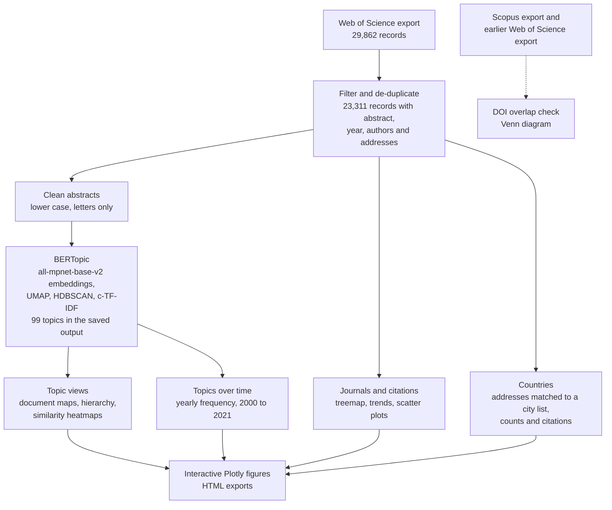

# Topic modelling of the synthetic biology literature

A Google Colab notebook and its exported Plotly figures. The notebook builds a BERTopic topic model of 23,311 Web of Science abstracts on synthetic biology and analyses topics over time, journals, citations and countries. In the saved outputs, the largest topics are `0 metabolic production pathway` (2,143 abstracts) and `4 circuits biological synthetic` (1,501), ACS Synthetic Biology has the most papers (2,457 of 23,237), and the United States and China have the most address records (20,826 and 10,045 of 68,278).

It is the code for the topic modelling and bibliometric parts of this paper:

> Meier F, Dixon T, Williams T, Paulsen I. Navigating the Frontier of Synthetic Biology: An AI-Driven Analytics Platform for Exploring Research Trends and Relationships. *ACS Synthetic Biology* 12(11), 3229-3241 (2023). [doi:10.1021/acssynbio.3c00192](https://doi.org/10.1021/acssynbio.3c00192)

The paper's abstract also describes a co-authorship network analysis, which is not in this repository. There is no web application either; the exported HTML figures are the interactive output. The notebook was last committed on 17 June 2023 and has not been updated since (see [Limitations](#limitations)).

 Hierarchical clustering of the 99 topics, from <code>hiearchy_color_threshold2-2.html</code>.

## Contents

| Path | Description |
|---|---|
| `New_NLP_analysis_of_synthetic_biology.ipynb` | The analysis: 101 cells, about 60 MB with saved outputs. GitHub reports it as too big to display, so download it and open it in Colab or Jupyter. Cell numbers in this README count code and Markdown cells from 0. |
| nine `.html` files | Interactive Plotly figures. GitHub does not render HTML, so download a file and open it in a browser. See [Saved outputs](#saved-outputs). |
| `docs/figures/` | Static previews of two of the HTML figures, rendered from the tracked files with headless Chrome. |

## Pipeline

Notebook cells by stage

| Stage | Cells | What the code does |
|---|---|---|
| Load and filter | 8-16 | Reads a Web of Science export of 29,862 records. Drops duplicate titles (29,412 left), keeps articles, reviews and proceedings papers (24,551), then keeps records that have an abstract, publication year, authors and addresses (23,311). |
| Clean abstracts | 17 | Lower-cases the text, removes URLs and words that start with "@", and keeps letters only. |
| Topic model | 34-47 | BERTopic with the settings below. The saved output has 99 topics. |
| Topic views | 48-53 | Document maps (`visualize_documents`, `visualize_hierarchical_documents`), topic hierarchy, and similarity heatmaps for all topics and for the 50 largest. |
| Topics over time | 54-64 | `topics_over_time` per publication year, 2000 to 2021. Line charts of yearly counts and of percentage share, and a bar chart of share. |
| Journals and citations | 65-77 | Papers and mean citations per journal (treemap), journals over time, the ten most cited papers, citations against publication year and against 180-day usage count. |
| Countries | 78-100 | Splits each address field at `;`, matches city and country names against the SimpleMaps World Cities list by substring, then plots a world map, a density map, papers and citations per country over time, and citation box plots. |
| Side checks | 20-32 | DOI overlap between an earlier Web of Science export and a Scopus export (9,598 DOIs in both, 6,046 only in Web of Science, 3,289 only in Scopus, with Scopus limited to records that have a PubMed ID). A word cloud of Keywords Plus. Publications per year. |

## Topic model settings (cells 38 to 42)

| Component | Setting |
|---|---|
| Embeddings | `all-mpnet-base-v2` through sentence-transformers |
| UMAP | `n_neighbors=15`, `n_components=5`, `min_dist=0.0`, cosine metric, no random seed |
| HDBSCAN | `min_cluster_size=15`, euclidean metric, `cluster_selection_method='eom'` |
| Topic words | Cell 38 sets `CountVectorizer(ngram_range=(1, 3), stop_words="english")` and class-based TF-IDF. Cell 42 calls `update_topics` without a vectorizer, so the saved topic words come from a default `CountVectorizer`: single words, keeping stop words such as "the" and "was". |
| Topic number | `nr_topics=100` requested, `calculate_probabilities=True` |
| Outliers | `reduce_outliers`, then `update_topics` (cells 41 and 42) |
| Labels | Cell 38 sets a `MaximalMarginalRelevance` representation, then replaces it with an OpenAI `gpt-3.5-turbo` model. Cell 42's `update_topics` call drops it, so the topic names saved in cells 43 to 45 are keyword lists such as `0_metabolic_production_pathway_engineering`. |

## Saved outputs

 Journal treemap from <code>journal_treemap-2.html</code>.

Eight HTML files hold exactly the figure saved in the notebook cell listed below (same data and layout).

HTML files by notebook cell

| File | Cell | Content |
|---|---|---|
| `hiearchy_color_threshold2-2.html` | 50 | Hierarchical clustering of the 99 topics |
| `heatmap_top100.html` | 52 | Similarity matrix of the 99 topics |
| `dynamic_topic_modelling_absolute.html` | 61 | Publications per year for each topic, 2000 to 2021 |
| `journal_treemap-2.html` | 70 | Treemap of 3,375 journals. Area is paper count, colour is mean citations. |
| `pie_chart_countrie.html` | 90 | Share of address records by country |
| `countries_over_time_others.html` | 97 | Address records per year for 15 countries and "other" |
| `top10countries_cit_count_desc.html` | 99 | Citation counts by country, box plots on a log axis. The file name says 10; the figure shows 15 countries and "other". |
| `all countries.html` | 100 | Citation counts by publication year, box plots on a log axis |
| `topic_vis.html` | none | "Documents and Topics" map from an earlier run: 14,854 documents in 50 topics. The current notebook does not write this file. |

## Running the notebook

The notebook was not re-run when this README was written.

1. Use Colab with a GPU runtime (the notebook metadata records a T4). The saved pip output shows Python 3.10, pandas 1.5.3, torch 2.0.1 and plotly 5.13.1. BERTopic, sentence-transformers, UMAP and HDBSCAN were installed without version pins, and their versions are not recorded.
2. Put the input files listed under [Data](#data) in `MyDrive/Coding data/` on Google Drive.
3. Delete the last two lines of cell 38, which set an OpenAI key and model: cell 42 discards their labels, and BERTopic 0.16 and later reject the call without a `client` argument. Delete the `py.plot(...)` lines too: they upload to Chart Studio, whose chart pages now return HTTP 410 (checked on 20 November 2026). No API keys are then needed.
4. Cells 21 and 22 replace `file1` with the older export for the Scopus comparison, so every later cell that reads `file1` (word cloud, publications per year, journals, countries) would use it. Skip cells 20 to 24, or run them last.

## Data

None of these files is in the repository.

| File | Use |
|---|---|
| `expanded_query.xlsx` | Web of Science export for the topic model and all later analyses (29,862 records before filtering) |
| `18k_articles.xlsx` | Earlier Web of Science export, used for the Scopus comparison |
| `scopus.csv` | Scopus export, used for the Scopus comparison |
| `worldcities.csv` | [SimpleMaps World Cities](https://simplemaps.com/data/world-cities), used to place addresses |

The search strings for the two exports are not recorded here. Text from the exports does appear in some saved outputs: cleaned abstracts in the hover labels of the document map (cell 48 and `topic_vis.html`) and article titles in the hover labels of cells 76, 77 and 85.

## Limitations

- **Age.** The saved yearly series stop in 2021 (topics over time) and 2022 (publications per year), and the country data include part of 2023.
- **Reproducibility.** One notebook, no environment file, no pinned versions, and inputs that are not included. It relies on Colab and Google Drive paths. UMAP has no random seed, so a new run can give different topics. The notebook does not measure topic coherence or stability.
- **Saved outputs.** They come from more than one Colab session. Cell 56 stores a `NameError`, and cell 57 reloads CSV files written earlier. The `CustomName` column in cell 45 is offset by one topic (topic 0 reads `1 biology synthetic research`); the figures are aligned. The trained model (cell 46) and the topic tables (cells 47 and 56) are not in the repository.
- **Corpus.** Some of the 99 topics are only loosely related to synthetic biology, for example `98 graphene nanoparticles silver`.
- **Countries.** The country figures count addresses, so a paper with authors in several countries is counted several times. City and country names are found by substring matching, so mismatches are possible.

## History

An earlier version of the notebook (March 2023, 14,854 abstracts) was deleted from this repository in June 2023 and remains in the Git history. A copy of it is also in [Navigating-the-frontier-of-Synthetic-Biology-An-AI-driven-platform-for-exploring-research-trends-an](https://github.com/SynBioExplorer/Navigating-the-frontier-of-Synthetic-Biology-An-AI-driven-platform-for-exploring-research-trends-an), which has no other code and was last pushed in March 2023.

## Licence

This repository is licensed under the MIT License, as the README has stated since November 2024. There is no LICENSE file yet.
